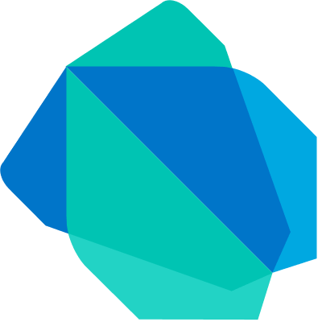
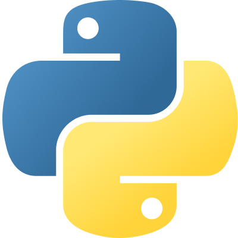
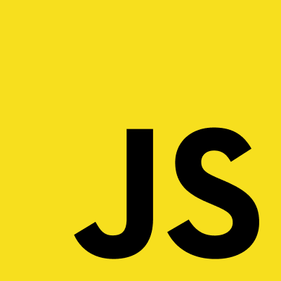
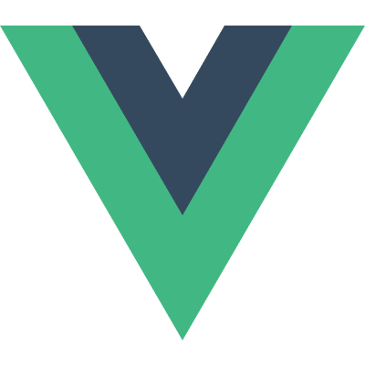
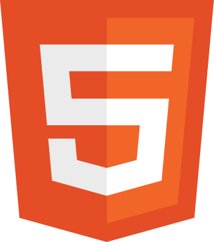
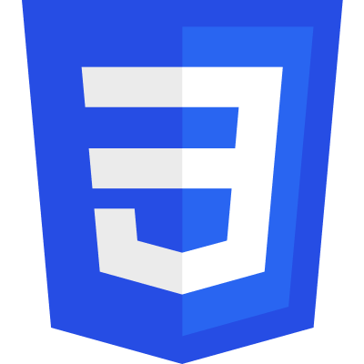
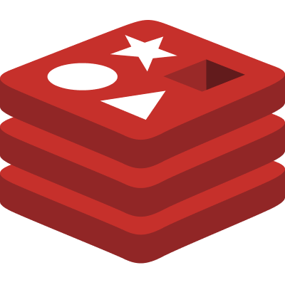
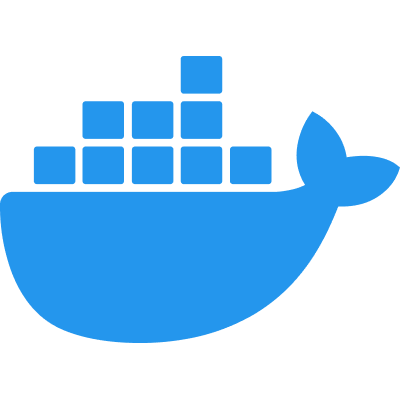

 

# `> DSF1re_`

**Full Stack Developer · Flutter & Dart Enthusiast**

 

---

### Tech Stack

  &nbsp;&nbsp;
  &nbsp;&nbsp;
  &nbsp;&nbsp;
  &nbsp;&nbsp;
  &nbsp;&nbsp;
  &nbsp;&nbsp;
  &nbsp;&nbsp;
  &nbsp;&nbsp;
  &nbsp;&nbsp;
  &nbsp;&nbsp;
  &nbsp;&nbsp;
  

---

### About Me

I'm a **full stack developer** with a strong focus on **Flutter & Dart** for building cross-platform mobile and web applications. I enjoy crafting clean, performant UIs on the frontend and designing solid, scalable systems on the backend.

- &nbsp;Currently building cross-platform apps with **Flutter**
- &nbsp;Backend experience with **Python**, **C# / .NET**, and **PostgreSQL**
- &nbsp;Comfortable with **Docker** and containerized workflows
- &nbsp;Passionate about clean architecture and pixel-perfect interfaces

---

⚡ *"Code is like fire — handle it right, and it lights the way."* ⚡

